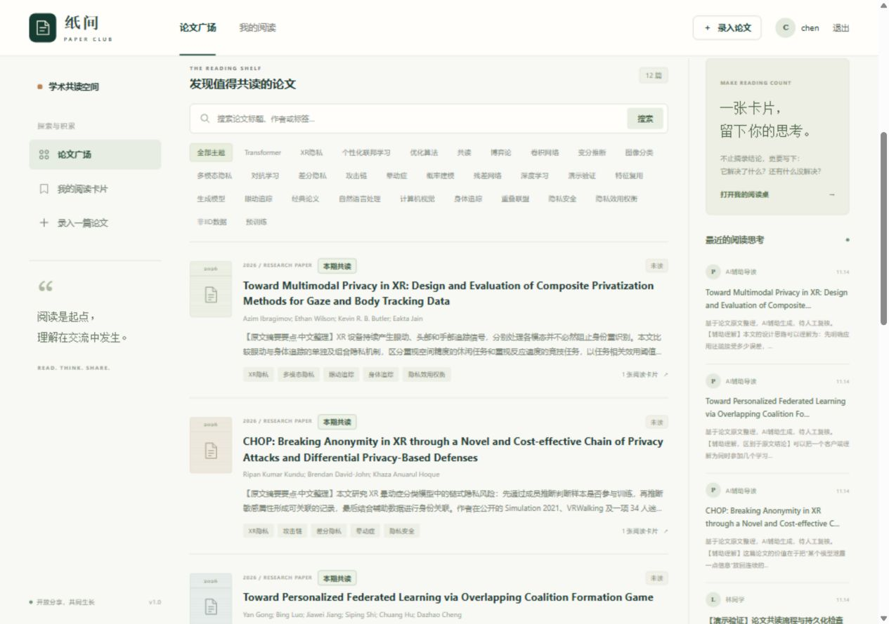

# 纸间 · Paper Club

面向高校学生的论文共读与阅读卡片应用。把“收藏一篇论文”推进到“梳理问题、记录理解、与同学讨论、导出自己的笔记”。



[阅读卡片与共读讨论截图](docs/screenshots/card.jpg) · [手机宽度预览](docs/screenshots/mobile.jpg) · [实际验证记录](docs/VERIFICATION.md)

首版使用 **Python + Django 5.2 LTS + SQLite + Django 模板**，界面与样式资源均在仓库内。核心功能在本机运行，不调用模型 API，不需要 GPU。访问论文原文链接需要联网，初始化数据库和使用已安装的应用无需获取外部内容。

## 功能

- 注册、登录、退出；匿名用户可浏览公开内容，登录后可录入论文、写卡片和评论。
- 手动录入论文标题、作者、年份、摘要、标签、原文链接，以及可选的 DOI 和代码链接。
- 一篇论文允许多位用户分别维护阅读卡片，按“研究问题、核心方法、主要结果、局限、个人理解、待讨论问题”组织。
- 每人独立记录未读、在读、已读状态；同学之间互不影响。
- 按标题、作者和标签检索论文；在“我的阅读卡片”中检索与筛选，列表支持分页。
- 查看他人卡片并评论。论文仅录入者可编辑，卡片和评论仅作者可修改或删除。
- 有阅读卡片关联的论文受到删除保护，避免删除整篇共读内容。
- 将一张卡片导出为 Markdown，将一篇论文导出为 BibTeX，支持中文和缺失 DOI。
- 可重复初始化的演示数据，以及 GitHub Actions 检查配置。

**数据公开范围：** 首版论文、卡片、评论和导出均公开给应用访问者；“我的卡片”用于筛选自己的内容，不代表私密笔记。

## 环境

- Python **3.11–3.14**，建议使用对应系列的最新补丁版本；本次开发使用已有的 Python 3.13.5。
- SQLite 随 Python 提供。
- 首次安装依赖需要网络；准确版本见 `requirements.txt`。

Django 5.2 对 Python 的支持范围见[官方发行说明](https://docs.djangoproject.com/en/5.2/releases/5.2/)。本仓库固定的依赖组合要求 Python 3.11 或更高，因此以本 README 的运行要求为准。

## Windows PowerShell 启动

在项目目录打开 PowerShell，按顺序执行：

```powershell
python -m venv .venv
.\.venv\Scripts\python.exe -m pip install -r requirements.txt
.\.venv\Scripts\python.exe manage.py migrate
.\.venv\Scripts\python.exe manage.py seed_demo
.\.venv\Scripts\python.exe manage.py import_papers
.\.venv\Scripts\python.exe manage.py runserver 127.0.0.1:8000
```

浏览器打开 [http://127.0.0.1:8000](http://127.0.0.1:8000)。直接调用虚拟环境中的 Python，不必先激活环境。

也可以在允许执行本地脚本的 PowerShell 中运行：

```powershell
.\start_demo.ps1
```

脚本会检查并创建虚拟环境，安装依赖，执行迁移和演示初始化，然后启动服务。若当前执行策略禁止脚本，使用上面的逐条命令即可。更换本地端口：

```powershell
.\start_demo.ps1 -Port 8001
```

## Linux / macOS 启动

```bash
python3 -m venv .venv
.venv/bin/python -m pip install -r requirements.txt
.venv/bin/python manage.py migrate
.venv/bin/python manage.py seed_demo
.venv/bin/python manage.py import_papers
.venv/bin/python manage.py runserver 127.0.0.1:8000
```

或者运行 `sh start_demo.sh`；可用 `sh start_demo.sh 8001` 更换端口。Linux 若提示缺少 `venv` 模块，需要安装发行版提供的 Python venv 组件。

终端中按 `Ctrl+C` 停止服务。再次运行 `runserver` 会读取原来的 SQLite 数据库，保留此前保存的内容。

## 演示账号与样例

| 用户名 | 新建账号初始密码 | 角色 |
| --- | --- | --- |
| `lin` | `PaperClub2026!` | 普通用户，显示名为林同学 |
| `chen` | `PaperClub2026!` | 普通用户，显示名为陈同学 |

`seed_demo` 在干净数据库中创建 8 篇论文、10 张卡片、10 条评论和两位用户各自的阅读状态。所有示例卡片、评论和导读都明确标为演示内容，论文原文链接指向真实公开来源。

重复运行 `seed_demo` 会通过不可编辑的稳定 `demo_key` 复用相同论文，不覆盖已编辑的内容、不重置密码；即使修改过论文标题或原文链接，也不会重新生成相同样例。旧版演示数据仅在原链接匹配且归属于专属演示账号时回填标识，普通用户录入的同链接论文不会被认作样例。命令只会在新建专属演示账号时设置上表中的初始密码。专属账号使用 `@demo.paper-club.invalid` 邮箱标记；若 `lin` 或 `chen` 已由其他账号占用，命令会拒绝整次初始化并给出说明，不向那些账号写入样例。正式使用时可直接注册自己的账号，演示账号仅用于本机演示。

论文元数据来源如下，年份统一采用 **首次 arXiv 提交年份**，可能与会议出版年份不同：

| 论文 | 年份 | 来源 |
| --- | --- | --- |
| Attention Is All You Need | 2017 | [arXiv:1706.03762](https://arxiv.org/abs/1706.03762) |
| BERT: Pre-training of Deep Bidirectional Transformers for Language Understanding | 2018 | [arXiv:1810.04805](https://arxiv.org/abs/1810.04805) |
| Deep Residual Learning for Image Recognition | 2015 | [arXiv:1512.03385](https://arxiv.org/abs/1512.03385) |
| Densely Connected Convolutional Networks | 2016 | [arXiv:1608.06993](https://arxiv.org/abs/1608.06993) |
| Auto-Encoding Variational Bayes | 2013 | [arXiv:1312.6114](https://arxiv.org/abs/1312.6114) |
| Generative Adversarial Networks | 2014 | [arXiv:1406.2661](https://arxiv.org/abs/1406.2661) |
| Adam: A Method for Stochastic Optimization | 2014 | [arXiv:1412.6980](https://arxiv.org/abs/1412.6980) |
| An Image is Worth 16x16 Words: Transformers for Image Recognition at Scale | 2020 | [arXiv:2010.11929](https://arxiv.org/abs/2010.11929) |

约三分钟的完整讲解流程见 [演示步骤](docs/DEMO.md)。

## 本期真实论文与原文导读

新增三篇用户提供的完整论文：XR 多模态隐私、CHOP 隐私攻击链，以及重叠联盟个性化联邦学习。它们使用正式出版年份 **2026**，并在论文广场优先展示。每篇有一张按 PDF 全文整理的中文阅读卡片，关键结论注明 PDF 页码、章节或图表；页面和 Markdown 导出均标注 **“基于论文原文整理，AI辅助生成，待人工复核”**。

| 论文 | 内容与来源对照 |
| --- | --- |
| Toward Multimodal Privacy in XR | [来源与核对说明](docs/papers/xr-multimodal.md) |
| CHOP: Breaking Anonymity in XR | [来源与核对说明](docs/papers/chop.md) |
| Toward Personalized Federated Learning via Overlapping Coalition Formation Game | [来源与核对说明](docs/papers/pfl-coalitions.md) |

完整元数据、阅读卡片及证据位置位于 `data/papers/*.json`。在已迁移数据库上运行 `python manage.py import_papers` 即可重建；重新克隆时按上方启动步骤执行即可。PDF 正文、原文页面图片、全文提取文本、本机路径与数据库不随源码交付。

导入根据固定来源标识保持稳定关联，首次按 DOI、原文链接、标题寻找已有论文，复用时保留其元数据及作者。导入自己新建的内容以后，仅同步仍等于上一版导入值的字段；手动修改过的字段保持原样。其他演示数据和用户卡片、评论不受影响。导读账号 `paperclub_ai` 显示为 AI 辅助导读，创建时设置不可用密码；读者使用自己的账号或 `lin` / `chen` 写卡片、评论。

详细命令、合并规则、未知信息和演示流程见 [真实论文导入说明](docs/CURATED_IMPORT.md)。

## 检查与测试

Windows：

```powershell
.\.venv\Scripts\python.exe manage.py check
.\.venv\Scripts\python.exe manage.py makemigrations --check --dry-run
.\.venv\Scripts\python.exe manage.py test
```

Linux / macOS：

```bash
.venv/bin/python manage.py check
.venv/bin/python manage.py makemigrations --check --dry-run
.venv/bin/python manage.py test
```

测试使用独立的测试数据库，不会清空本机 Demo 数据。重点验证匿名读写边界、跨用户修改权限、论文删除保护、独立阅读状态、检索和导出，以及演示初始化的重复执行。GitHub Actions 在 Python 3.11 和 3.13 上执行相同检查；远程 CI 的实际结果需要推送仓库后查看。

本机 Windows / Python 3.13.5 实测 **50 项测试全部通过**，迁移一致性检查通过。首版完整流程与重启持久化、三篇真实论文导入与重复导入、已有内容保留、三篇检索与六份浏览器导出均已验证。详细过程和范围见 [VERIFICATION.md](docs/VERIFICATION.md) 及 [CURATED_IMPORT.md](docs/CURATED_IMPORT.md)；上述命令也用于在另一台电脑复验。

## 目录结构

```text
paper-club/
├── manage.py
├── requirements.txt
├── paperclub/                 # 配置、根路由、WSGI / ASGI 入口
├── club/
│   ├── models.py              # 论文、阅读卡片、阅读状态、评论
│   ├── forms.py               # 输入校验与表单
│   ├── views.py               # 页面和权限验证
│   ├── exports.py             # Markdown / BibTeX
│   ├── migrations/            # 可重建数据库的迁移文件
│   ├── management/commands/seed_demo.py
│   └── tests/                 # 权限、持久化、检索、导出和初始化测试
├── templates/                 # 中文 Django 模板
├── static/club/               # 本地样式与界面资源
├── docs/                      # 演示、架构与验证记录
├── .github/workflows/tests.yml
├── start_demo.ps1
└── start_demo.sh
```

## 配置

默认设置适合本机演示。环境变量由当前终端传入，项目**不会自动加载 `.env`**。

| 环境变量 | 默认值 / 用途 |
| --- | --- |
| `DJANGO_DEBUG` | `1`，本机开发模式；设为 `0` 使用非调试配置 |
| `DJANGO_SECRET_KEY` | 默认仅本机开发密钥；关闭 DEBUG 时必须提供自己的密钥 |
| `DJANGO_ALLOWED_HOSTS` | `127.0.0.1,localhost,[::1]`；以逗号分隔主机名 |
| `PAPERCLUB_DB_PATH` | 项目目录中的 `db.sqlite3`；可指定另一数据库文件路径 |

例如，另用一个开发数据库时，在 PowerShell 中先设置 `$env:PAPERCLUB_DB_PATH = 'demo-local.sqlite3'`，再运行迁移、初始化与服务。Linux / macOS 使用 `export PAPERCLUB_DB_PATH=demo-local.sqlite3`。选定的路径需可写；保留已有数据库即可保留其数据。

`runserver` 是本机开发服务器。未来部署服务器时，需要单独配置 WSGI / ASGI 服务、静态文件、正式密钥、域名及访问方式；本次交付以本机演示为目标。服务器上的已有 `11112` Demo 与本项目默认的本机 `8000` 端口是两件事，统一部署时再由维护者分配端口。

## 上传 GitHub

源码、迁移和样例初始化逻辑应纳入版本管理；虚拟环境、SQLite 数据库、个人环境变量文件及运行产物通过 `.gitignore` 排除。别人克隆源码后使用迁移和 `seed_demo` 即可重建演示，无需复制你的本机数据库。

在 GitHub 创建一个空仓库后，在本项目根目录执行（替换示例地址）：

```bash
git init
git add .
git status --short
git diff --cached --stat
git commit -m "Build Paper Club demo"
git branch -M main
git remote add origin https://github.com/YOUR_NAME/paper-club.git
git push -u origin main
```

推送要求当前电脑已完成 GitHub 身份验证，且账号对目标仓库具有写权限。若项目已初始化或已配置 remote，先用 `git status` 和 `git remote -v` 确认状态，按现有仓库协作方式提交。汇入团队仓库时建议提交独立分支与 Pull Request，由维护者审核。

本项目新编写的代码使用 [MIT 许可证](LICENSE)。仓库中的论文链接及原论文作品保持各自的授权；示例笔记是本项目编写的功能演示文本。

## 设计与后续扩展

架构和权限设计见 [ARCHITECTURE.md](docs/ARCHITECTURE.md)，协作方式见 [CONTRIBUTING.md](CONTRIBUTING.md)。

当前采用公开共享与单机 SQLite，适合展示和小规模试用。SQLite 在较高并发写入时存在限制。正式多人服务可迁移 PostgreSQL，并增加统一登录、私密或组内内容权限、审核和备份。后续如需文献自动导入或 AI 能力，可在现有稳定主键和业务模块上扩展；首版已经可以独立演示完整共读流程。
