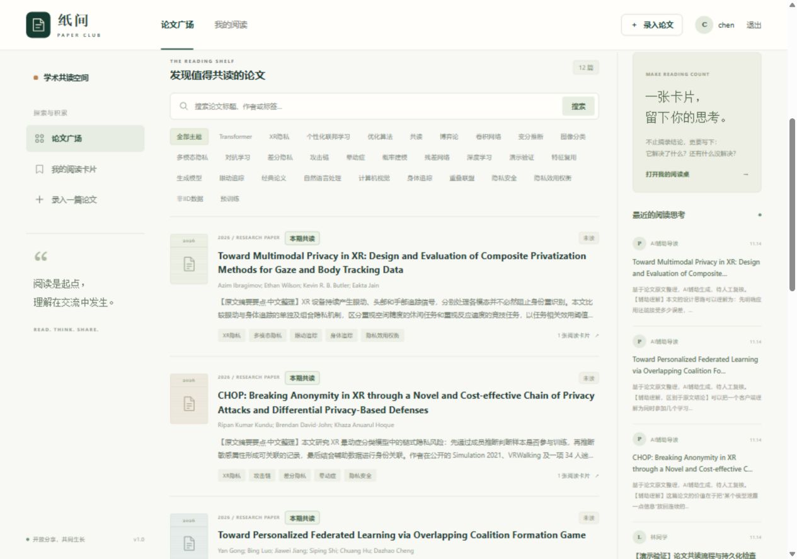

# 三篇真实论文导入与验证

本批次依据用户提供的正式版PDF全文整理，所有页码从所提供文件首页起计。内容均标注：**基于论文原文整理，AI辅助生成，待人工复核**。原文结论、表格转录与辅助理解分别标识。

## 本次录入结果

| 来源标识 | 正式出版 | 本机论文 / 卡片 | PDF页数 |
| --- | --- | --- | --- |
| `xr-multimodal` | IEEE TVCG 32(5):4396–4407, 2026 | [论文12](http://127.0.0.1:8000/papers/12/) / [卡片14](http://127.0.0.1:8000/cards/14/) | 12 |
| `chop` | IEEE VR 2026, pp.626–636 | [论文10](http://127.0.0.1:8000/papers/10/) / [卡片12](http://127.0.0.1:8000/cards/12/) | 11 |
| `pfl-coalitions` | IEEE TMC 25(8):11790–11803, 2026 | [论文11](http://127.0.0.1:8000/papers/11/) / [卡片13](http://127.0.0.1:8000/cards/13/) | 14 |

表中数字是本机数据库主键，新数据库以导入输出为准。优先顺序为多模态隐私、CHOP、个性化联邦学习；后来添加普通论文仍保留该顺序。原有演示数据全部保留。

## 主要来源与待核实事项

- 多模态隐私：[正式DOI](https://doi.org/10.1109/TVCG.2026.3679093)、PDF首页、作者项目页和[官方SDK](https://github.com/azimIbragimov/XR-Privacy-SDK)。代码地址已录入，预印本年份未确认。卡片区分单模态/融合识别率、强攻击者风险、Chimera合成身份与真实同步数据；训练划分口径仍需结合实现复核。详见[完整对照](papers/xr-multimodal.md)。
- CHOP：[正式DOI](https://doi.org/10.1109/VR67842.2026.00082)、PDF首页与表格、出版方元数据。代码和预印本年份未确认；摘要、正文与表5存在数字差异，身份真值、参与者重叠和部分攻击权限描述也待复核。保留差异，不拼接不同设置的数字。详见[完整对照](papers/chop.md)。
- 个性化联邦学习：[正式DOI](https://doi.org/10.1109/TMC.2026.3668791)、PDF首页和表V、[作者机构记录](https://scholars.duke.edu/publication/1706532)。代码和预印本年份未确认；作者个人主页与正式版名单有差异，按PDF与机构记录一致的六位作者录入。PDF没有所引附录，不声称已核对全部证明；稳定结构表述保留讨论。详见[完整对照](papers/pfl-coalitions.md)。

元数据和卡片位于 `data/papers/*.json`，包含六字段卡片、出版信息、来源链接、关键结论对照和待核实项。没有把收稿日期或本机文件夹日期当作预印本年份。原文页面只用于本地核对，正文、全文提取文本、页面渲染和数据库备份均不随源码发布。

## 重建和重复导入

按README安装固定依赖后，在项目目录运行：

```powershell
.\.venv\Scripts\python.exe manage.py migrate
.\.venv\Scripts\python.exe manage.py seed_demo
.\.venv\Scripts\python.exe manage.py import_papers
.\.venv\Scripts\python.exe manage.py runserver 127.0.0.1:8000
```

`seed_demo`保留原有样例，可按需要省略。两个启动脚本已加入 `import_papers`。Linux使用 `.venv/bin/python`。命令另支持 `--data-dir` 指向相同结构的JSON目录。

导入先校验整批文件，再在事务内写入。首次按DOI、原文链接、规范化标题依次寻找已有论文；出现多个匹配项或DOI冲突时停止自动合并并回滚。复用已有用户论文时，保留其元数据、录入者、卡片及评论，为导读建立独立卡片。

自己新建的导入记录以固定来源标识关联，并保存上一版导入值；再次执行仅更新仍等于上一版值的字段，已经手动改过的字段保持原样。修改标题或链接不会破坏来源关联。

导读账号 `paperclub_ai` 显示名为“AI辅助导读”，创建时设置不可用密码。读者使用自己的账号或 `lin` / `chen` 写各自的卡片、评论。本次导入没有修改读者阅读状态，也没有创建虚构讨论。

## 实际验证

环境：2026-11-14，Windows，Python 3.13.5，Django 5.2.19，SQLite。

- 第一次实际导入新增3篇论文、3张卡片；第二次新增0篇、0张。
- 导入前后逐字段比对：原9篇论文、11张卡片、11条评论、17条阅读状态均未改变。当前共12篇论文、14张卡片、11条评论。
- `manage.py check`无问题；`makemigrations --check --dry-run`无变化。
- 完整测试：**50项，16.787秒，全部通过**。包括手动编辑保留、DOI复用、账号碰撞回滚、重复导入、优先顺序，以及干净测试库重建三篇内容并导出。
- 浏览器逐篇打开详情、展开来源、打开卡片，下载3份BibTeX和3份Markdown，并核对中文、DOI、六字段、来源链接与AI辅助标注。
- 分别搜索 `Multimodal Privacy`、`CHOP`、`Overlapping Coalition`，各返回对应一篇论文；首页前三项顺序正确。
- 1280×900桌面和390×844手机视口均无横向溢出；手机来源面板长文件名和链接可换行。结束后已恢复原视口，并保留更新后的Demo页面。
- 未运行论文原始实验、作者代码或独立证明复现；Linux/macOS和远程GitHub CI仍未实际验证。

## 三分钟演示

1. 0:00–0:30：展示首页三篇本期共读论文，从正式年、作者和DOI说明资料来源。
2. 0:30–1:20：打开带原文依据的卡片，展示研究问题、方法、结果和页码引用。
3. 1:20–2:00：展开来源说明，展示AI辅助标注和待核实事项；以CHOP说明如何保留原文数字差异。
4. 2:00–2:30：用个人/演示账号另写自己的卡片或评论，区分公共导读与个人理解。
5. 2:30–3:00：搜索CHOP，展示BibTeX与Markdown导出，并说明克隆后可重建，PDF保留本地。

## 真实截图



- [多模态隐私卡片](screenshots/curated-xr-multimodal.jpg)
- [CHOP卡片](screenshots/curated-chop.jpg)
- [个性化联邦学习卡片](screenshots/curated-pfl-coalitions.jpg)
- [手机来源说明](screenshots/curated-mobile-source.jpg)
